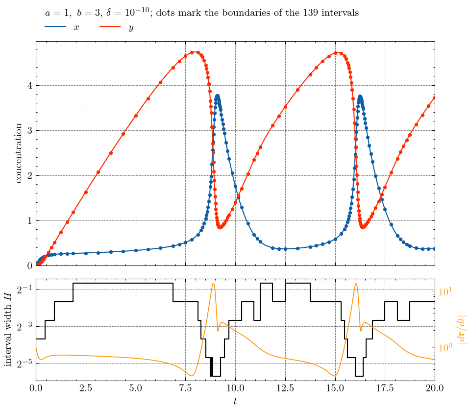
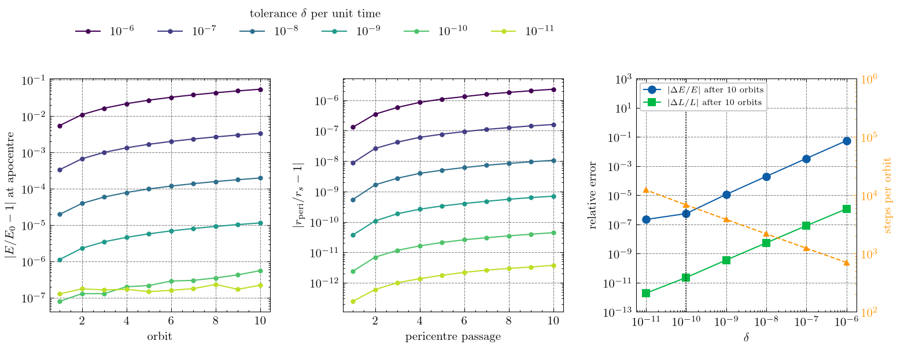
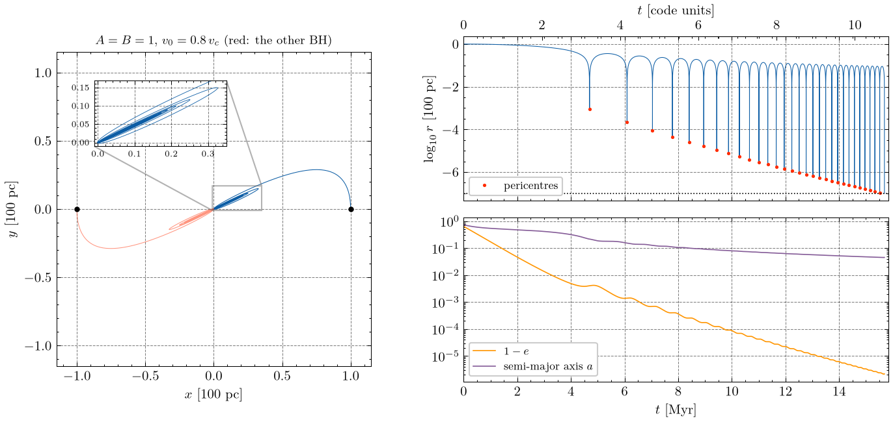
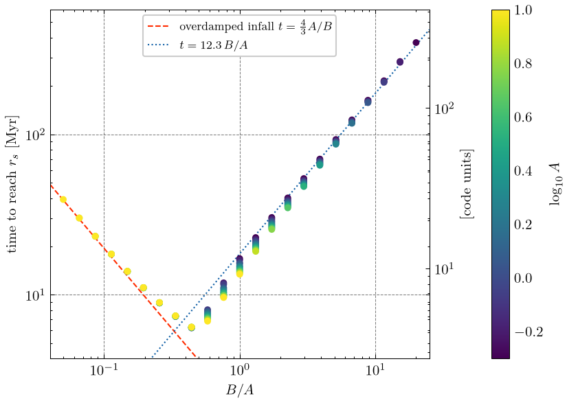
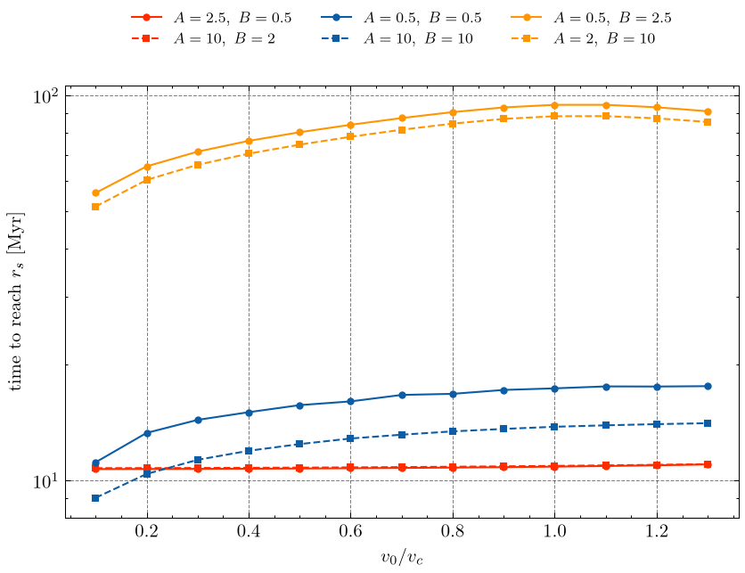

# Computational Physics — Homework 4

Adaptive ODE integration: the Brusselator with recursive Bulirsch–Stoer
(Newman 8.18), and a supermassive black-hole binary sinking by dynamical
friction with adaptive RK4.

## Running

The project uses [uv](https://docs.astral.sh/uv/). Figures use
[SciencePlots](https://github.com/garrettj403/SciencePlots) with LaTeX text, and
`plotstyle.py` falls back to matplotlib mathtext if no LaTeX toolchain is found.

```
uv sync
uv run python problem1.py
uv run python problem2.py
```

`problem2.py` runs about 300 orbit integrations (numba-compiled, spread over all
cores) and takes about 4 minutes on 8 cores. Figures are written to `figs/` and
printed output is saved in `results/`. The homework writeup (Summary / Methods /
Results / Code) is [`writeup/hw4_writeup.pdf`](writeup/hw4_writeup.pdf), built
from `writeup/hw4_writeup.tex` with `latexmk -pdf`.

| file | contents |
| --- | --- |
| `plotstyle.py` | shared SciencePlots configuration |
| `problem1.py` | Brusselator, Bulirsch–Stoer with recursive interval halving, δ = 1e-10 |
| `bhorbit.py` | adaptive RK4 for one BH of the binary with dynamical friction, pericentre detection, units |
| `problem2.py` | parts (a)–(d): tolerance test, A = B = 1 orbit, B/A scan, v0 and A, B dependence |
| `comp_phys_hw4.pdf` | the assignment |

---

## Problem 1 — the Brusselator (Newman 8.18)

a = 1, b = 3, x = y = 0 at t = 0, solved to t = 20. Each interval goes through
modified-midpoint steps n = 1…8 with Richardson extrapolation. If the error is
still above Hδ (δ = 1e-10 per unit time, in both x and y), the interval is
halved recursively, starting from H = 20.

The fixed point (1, 3) is an unstable spiral (eigenvalues ½ ± i√3/2), so the
solution settles onto a limit cycle with period ≈ 7.1. The solver accepts **139
intervals**, with widths from 0.625 down to 0.0195 that crowd together at the fast
switches (the correlation between log H and log|dr/dt| is −0.80). At t = 20,
x = 0.3751036102 and y = 3.7279158358. These differ by 5e-11 and 7e-10 from a
δ = 1e-12 run, inside the 2e-9 target.



---

## Problem 2 — SMBH binary with dynamical friction

The equation of motion is d²r/dt² = −r/(4r³) − A v/(v³+B), with G = M = 1 and a
length unit of 100 pc. Gravity is attractive and the DF is a drag, although the
sheet writes both terms with a "+". r_s = 1e-7 fixes M = 1.05e8 M☉ per hole, and
then the time unit is 1.459 Myr. The integrator is adaptive RK4: one step of 2h is
compared with two steps of h, and the position error |Δr|/30 must be below hδ.

**(a)** I tested the tolerance on a frictionless Kepler orbit with apocentre 1 and
pericentre r_s (e = 1 − 2e-7), followed for 10 orbits:

| δ | steps/orbit | ΔE/E | ΔL/L | max \|r_p/r_s − 1\| |
| --- | --- | --- | --- | --- |
| 1e-6 | 706 | −5.5e-2 | −1.2e-6 | 2e-6 |
| 1e-8 | 2177 | −2.0e-4 | −5e-9 | 1e-8 |
| **1e-10** | **6830** | **−5.5e-7** | **−2e-11** | **4e-11** |
| 1e-11 | 12343 | +2.2e-7 (round-off) | −2e-12 | 4e-12 |

δ = 1e-12 stalls because the step drops below the spacing of doubles near t,
so I adopted **δ = 1e-10**.



**(b)** With A = B = 1 and v0 = 0.8 v_c, the binary reaches r_s at t = 10.756 =
**15.7 Myr**, after 30 pericentre passages. The first infall removes 95% of L.
After that the orbit is nearly radial: drag at the slow apocentres removes L
(exactly, dL/dt = −A L/(v³+B)), so 1 − e falls to 2e-6 while a is still 4.6 pc.



**(c)** On a 12×12 grid of A, B in [0.5, 10], the time to reach r_s traces a V
shape in B/A. It is shortest, **6.2 Myr, at B/A ≈ 0.44**, where the drag is
critically damped.

* **Overdamped (small B/A):** the hole never completes an orbit and sinks at
  terminal velocity, t = (4/3) A/B (within 2.5%).
* **Underdamped (large B/A):** many orbits, t ≈ 12.3 B/A, up to 374 Myr at
  B/A = 20. L must fall by ln(0.4/2.2e-4) ≈ 7.5 e-folds at a rate below A/B.



**(d)** In the overdamped regime v0 does not matter (3% change). In the orbiting
regime the time rises with v0 up to ≈ v_c, and a nearly radial start is 33–38%
faster. At fixed B/A, the individual values change t by < 1% (B/A < 0.45), 25%
(B/A ≈ 1) and 2% (B/A ≈ 12). The drag is −(A/B) v for v³ ≪ B, which depends on
the ratio only, but −A v/v³ for v³ ≫ B, which depends on A alone. So the
individual values matter only where the hole's speed crosses B^{1/3}.


